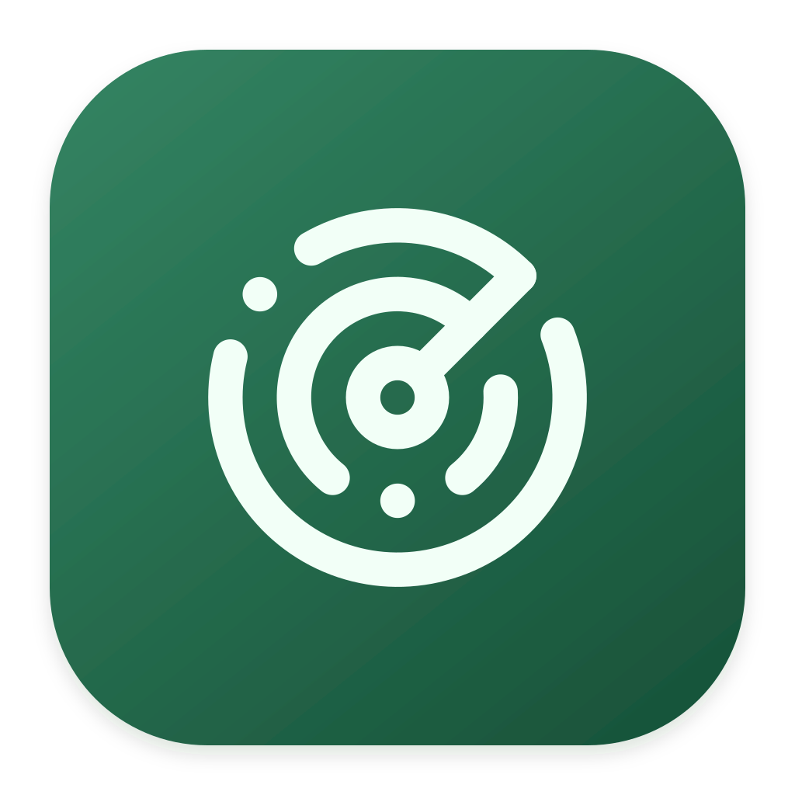
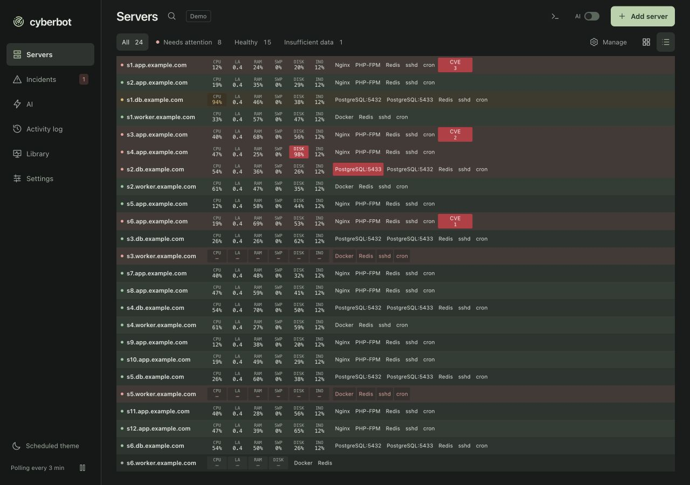
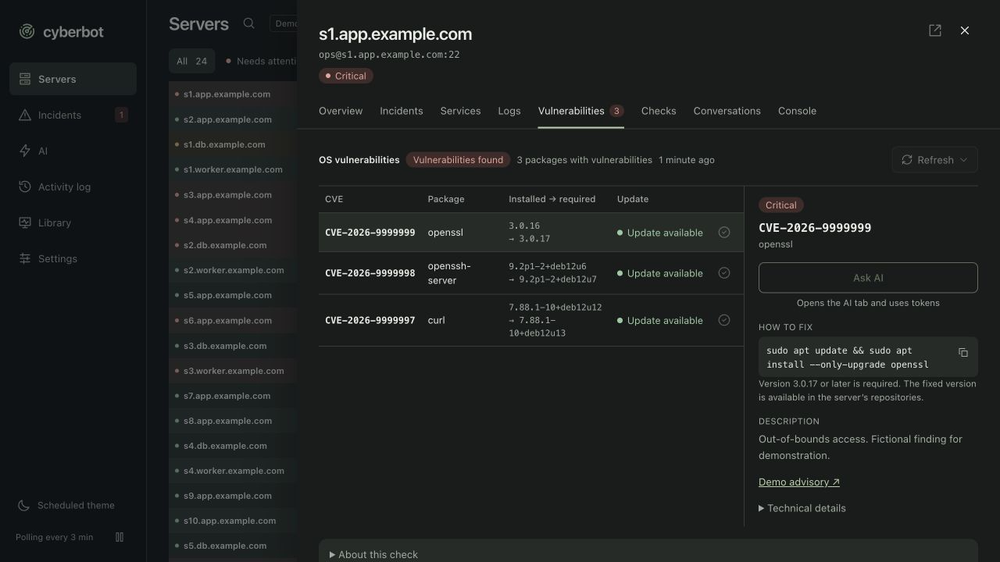

<p align="center">
  
</p>

<h1 align="center">Cyberbot</h1>

<p align="center">
  <strong>See what needs attention across your Linux servers.</strong><br>
  Monitor your fleet over SSH, investigate incidents, and review proposed actions from a macOS desktop app.
</p>

<p align="center">
  <a href="#get-started">Get started</a> ·
  <a href="docs/user-guide.md">User guide</a> ·
  <a href="CONTRIBUTING.md">Contribute</a>
</p>

<p align="center">
  <a href="https://github.com/cyberbot-ai/cyberbot/actions/workflows/ci.yml"></a>
  <a href="https://github.com/cyberbot-ai/cyberbot/releases/latest"></a>
  <a href="LICENSE"></a>
</p>



*Fleet overview with critical CVE counts highlighted in red.*



*OS vulnerability details for one server. Both screenshots use fictional demo data.*

## What Cyberbot does

- **Monitor a fleet from one screen.** View CPU, memory, load, disks, services, and incident status. Cyberbot shows when readings are stale, unavailable, or still pending.
- **Go from an alert to the evidence.** Open a server to inspect service metrics, incremental log summaries, critical package advisories on supported Ubuntu and Debian releases, and related incidents. Open an interactive SSH console when you need it.
- **Monitor application services independently.** Track databases, proxies, containers, and other services with [18 built-in connectors](docs/CONNECTORS.md). Several connectors support multiple instances on one host.
- **Investigate with an optional AI agent.** Use an installed Codex or Claude CLI to investigate incidents with scoped context. Routine monitoring runs without a model. Eligible changes go through Cyberbot's action policy and approval flow.

Cyberbot stores settings and monitoring history locally. It uses OpenSSH and deploys a versioned Python collector over rsync to the remote account's cache. It needs no always-running server daemon. See the [architecture](docs/architecture.md) for the data and trust boundaries.

## Get started

You need macOS 12 or later, Xcode Command Line Tools, Node.js 22.22.2 or a newer 22.x release, and stable Rust. The monitored Linux host needs SSH access, rsync, and Python 3. See the [Linux coverage matrix](docs/LINUX_PLATFORMS.md) for distro-specific capabilities.

1. Download a source archive from [GitHub Releases](https://github.com/cyberbot-ai/cyberbot/releases/latest), or clone the repository.

   ```sh
   git clone https://github.com/cyberbot-ai/cyberbot.git
   cd cyberbot
   ```

2. Run `make install` in the source directory. The installer builds and copies the app to `/Applications/Cyberbot.app`. Open Cyberbot from Applications or Spotlight.
3. Verify that `ssh user@host` works and that you have verified the host key. In Cyberbot, choose **Add server** and enter a host or import a [static Ansible inventory](docs/INVENTORY.md). The first poll starts automatically.

Releases contain source archives. Local builds use ad-hoc macOS signing. To update, quit Cyberbot from its menu, open the new source version, and run `make install` again. The installer preserves the app's data.

For a browser demo with fictional data, run `make deps` followed by `make web-dev`, then open the local URL printed by Vite.

## Documentation

| Topic | Guide |
| --- | --- |
| Setup, polling, incidents, and AI investigations | [User guide](docs/user-guide.md) |
| SSH collection, storage, and action approvals | [Architecture](docs/architecture.md) |
| Hosts, services, and incident grouping | [Inventory](docs/INVENTORY.md) · [Linux platforms](docs/LINUX_PLATFORMS.md) · [Connectors](docs/CONNECTORS.md) · [Incident groups](docs/INCIDENT_GROUPS.md) |
| Building, testing, and releasing | [Contributing](CONTRIBUTING.md) · [Changelog](CHANGELOG.md) |

Cyberbot is licensed under [GPL-3.0-only](LICENSE). See [third-party notices](THIRD_PARTY_NOTICES.md) for separately licensed components.
