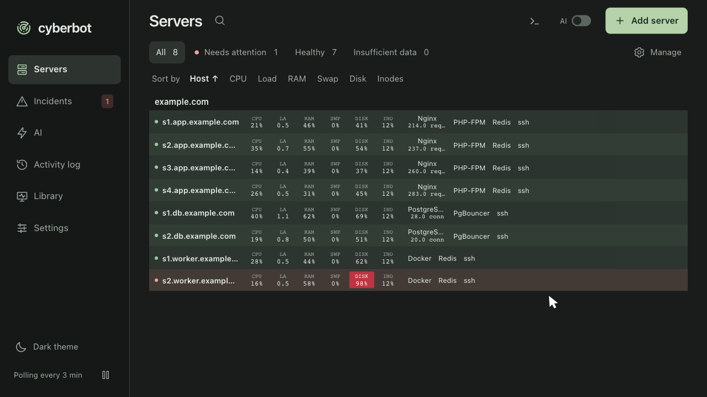
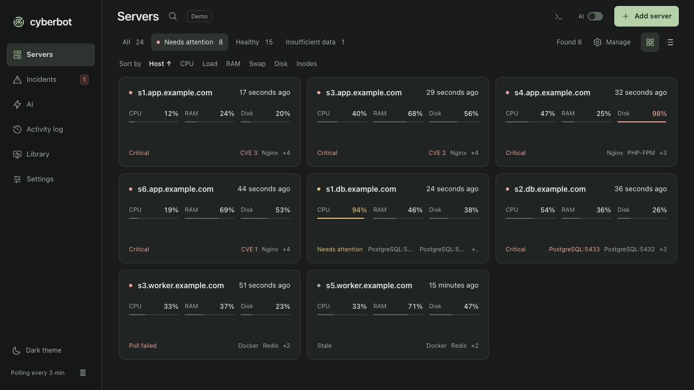
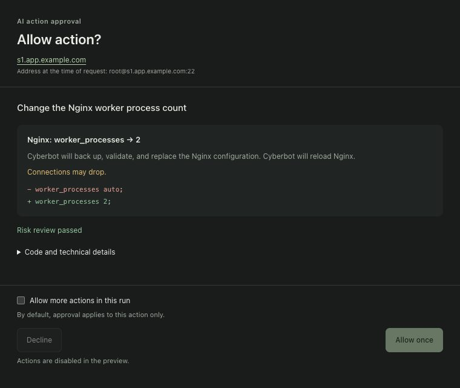
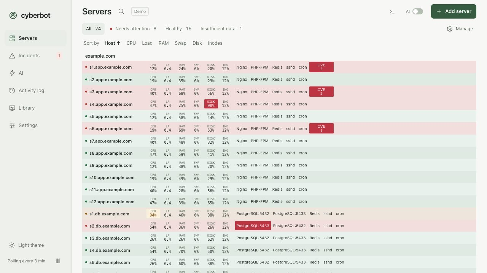
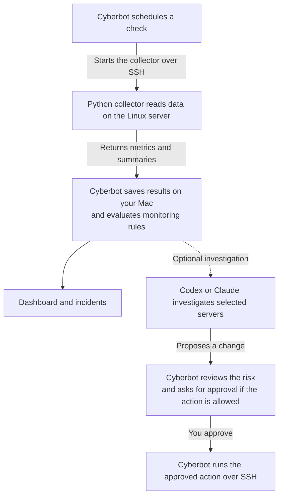

<p align="center">
  
</p>

<h1 align="center">Cyberbot</h1>

<p align="center">
  <strong>See what needs attention across your Linux servers.</strong><br>
  Monitor your fleet over SSH, investigate incidents, and review proposed actions from a macOS desktop app.<br>
  Get notified automatically when a critical vulnerability is found on one of your servers.
</p>

<p align="center">
  <a href="#features">Features</a> ·
  <a href="#how-it-works">How it works</a> ·
  <a href="#get-started">Get started</a> ·
  <a href="#faq">FAQ</a> ·
  <a href="docs/user-guide.md">User guide</a> ·
  <a href="CONTRIBUTING.md">Contribute</a>
</p>

<p align="center">
  <a href="https://github.com/cyberbot-ai/cyberbot/actions/workflows/ci.yml"></a>
  <a href="https://github.com/cyberbot-ai/cyberbot/releases/latest"></a>
  <a href="LICENSE"></a>
</p>



*This demo uses fictional data and simulates the console output and AI responses.*


*Fleet overview with critical CVE counts highlighted in red. All screenshots use fictional demo data.*

## Why Cyberbot

- **Nothing to run on your servers.** Cyberbot connects with the OpenSSH setup you already have and copies a Python collector into the remote account's cache. It needs no always-running daemon, no extra listening port, and no hosted backend.
- **Your data stays on your Mac.** Settings, inventory, and monitoring history live in a local SQLite database with fixed size limits.
- **Missing data is never shown as healthy.** Stale, unavailable, and pending readings are marked as such. Missing permissions and unsupported capabilities are listed next to the measurements that are available.
- **AI is optional and supervised.** Polling, rules, and incidents work without a model. If you connect a Codex or Claude CLI, the agent sees a fixed set of servers, and anything that can change a server waits for your approval.

## Features

Expand a feature to see the details and screenshots.

<details>
<summary><strong>Fleet dashboard.</strong> Resources, services, and incident status for every server on one screen.</summary>



*The server list filtered to the servers that need attention.*

- Watch CPU, memory, swap, load, disk space, inodes, detected services, and open incidents for every server on one screen.
- Filter by **Needs attention**, **Healthy**, or **Insufficient data**, search by name or address, and sort by any resource metric to compare servers.
- Add a list of SSH addresses or import a static Ansible inventory in INI, YAML, or JSON. Cyberbot rereads inventories every five minutes and keeps the last valid list if an update fails. Host sorting groups inventory servers by domain. See [inventory formats](docs/INVENTORY.md).
- Set one interval for server metrics, logs, service diagnostics, and installed packages, and allow up to 24 concurrent background polls. Pause or resume polling from the sidebar. Cyberbot keeps polling from the menu bar after you close the window and stops while your Mac is asleep.

</details>

<details>
<summary><strong>Server details and SSH console.</strong> One panel per server, with an interactive SSH session.</summary>

Open a server to see its overview, incidents, services, logs, vulnerabilities, checks, AI conversations, and console in one panel. You can open that panel in a separate window.

- The overview shows current metrics, recent CPU history, space and inode usage by mount point, OS details, and systemd service status. Use the refresh button next to the server name to poll the server on demand.
- The **Console** tab connects over SSH when you open it and keeps the interactive session open while you switch tabs.
- Polling, file sync, and the console share pooled OpenSSH connections. Host aliases, keys, and jump hosts from your SSH configuration keep working.

</details>

<details>
<summary><strong>Service connectors.</strong> 18 built-in connectors for databases, proxies, containers, and more.</summary>

Cyberbot tracks each detected service with its own profile, history, and incidents during the shared server poll. Several connectors support multiple instances on one server, such as two PostgreSQL clusters on different ports.

| Category | Built-in connectors |
| --- | --- |
| Web servers and proxies | Nginx, Caddy, Envoy |
| Databases and stores | PostgreSQL, MySQL or MariaDB, MongoDB, CockroachDB, ClickHouse, Redis, Qdrant |
| Connection poolers and proxies | PgBouncer, ProxySQL, Twemproxy |
| Runtimes | Docker, PHP-FPM |
| Network, security, and voice | Nebula, Fail2ban, Asterisk |

Diagnostics use local endpoints and credentials that already exist on the server. Configure the endpoint and diagnostic role per instance where supported. Nginx can show response codes and latency estimates, and PostgreSQL can show blocked sessions, replication lag, and maintenance statistics. See [connectors](docs/CONNECTORS.md) for the requirements of each service.

</details>

<details>
<summary><strong>Incidents and correlation.</strong> Incidents that keep their evidence and are grouped across related servers.</summary>

- Deterministic rules turn metrics, logs, service results, and package advisories into incidents. Every incident keeps its own evidence and history.
- Declare server dependencies in the server overview. Cyberbot uses those dependencies, shared jump hosts for connection failures, and matching check failures to group related incidents across servers. Each group shows why the incidents were linked and when they occurred. See [incident groups](docs/INCIDENT_GROUPS.md).
- Search incidents and groups by server, check, evidence, severity, or status. Resolve incidents individually or in bulk and include resolved incidents when reviewing history.
- Automatic recovery has to be confirmed by observations. Missing coverage cannot confirm it.
- Optional macOS notifications announce new incidents even while the window is hidden. Cyberbot combines incidents that arrive within five seconds, and clicking the notification opens the relevant incidents.

</details>

<details>
<summary><strong>OS vulnerabilities.</strong> Critical Debian and Ubuntu package checks, a fleet-wide CVE catalog, and APT upgrade commands.</summary>


*OS vulnerability details for one server.*

- Cyberbot matches installed packages against critical advisories for supported Debian and Ubuntu releases. Matching runs locally and does not use AI.
- Open **Library → Vulnerabilities** to browse local advisories and findings across the fleet. Search by CVE, title, package, or server, and filter by server or finding status.
- On a server, compare installed and fixed versions and check availability in the server's APT cache. Copy an upgrade command for one finding or a combined command for multiple eligible findings across all pages. Hide a package until its installed version changes, or restore it from the hidden list.
- Checks run on a schedule, and a new finding opens an incident. You can also refresh the server, update the vulnerability database from the Library, or use **Ask AI** to investigate whether a finding is exploitable on that server.

</details>

<details>
<summary><strong>System and SSH log analysis.</strong> Detect system errors, suspicious logins, and protection failures.</summary>

- Cyberbot reads logs incrementally on each server and returns event counts, findings, and redacted examples. The **Logs** tab shows which sources were read and where coverage was incomplete.
- Rules detect out-of-memory events, disk and filesystem errors, service crashes, Fail2ban errors, suspicious SSH logins after failed attempts, and recurring error patterns. Checks run without a model and can be refreshed on demand.

</details>

<details>
<summary><strong>Fleet console.</strong> One command on selected servers or the whole fleet.</summary>

Run one SSH command on up to 500 selected servers, with a confirmation step when you target the whole fleet. Review exit codes, output, and errors per server, filter to failures, or stop an active batch. The same page has an AI chat scoped to the selected servers.

</details>

<details>
<summary><strong>AI investigations with approvals.</strong> An optional agent with a fixed server scope that asks before it changes anything.</summary>

<p align="center">
  
</p>

*Approval request for a proposed Nginx configuration change.*

- Use an installed Codex or Claude CLI to investigate a server, an incident, or an incident group. Server and fleet chats keep conversation history and follow the language of your latest message.
- The agent's server requests go through Cyberbot's Model Context Protocol (MCP) gateway. Each run gets a fixed server scope that cannot grow while it is active.
- Read-only diagnostics can run without approval. Manual investigations can also read limited server file evidence and selected public HTTPS resources. Shell commands and other supported actions that can change a server require a separate risk review and your approval. See the [action policy](docs/architecture.md#proposed-actions).
- Review pending requests and past results under **AI → Actions**. Approval applies to the exact script, inputs, and SSH context. Eligible low-risk actions can use approval for the current run. Recoverable risks such as targeted security configuration repairs require one-time approval with a warning about the effects and recovery limits.
- The managed Nginx action changes `worker_processes`, backs up and validates the configuration, records a receipt, and offers rollback.
- Automatic investigations are off by default. When enabled, they use a persistent queue with incident deduplication and cooldowns. Review usage and history, skip queued jobs, or stop a running investigation. Set daily run and token limits, a per-run token limit, and models for the low, medium, and high profiles.

</details>

<details>
<summary><strong>Custom checks and the monitoring library.</strong> Your own declarative checks next to the built-in ones.</summary>

- The **Library** lists built-in checks with their sources, operations, and schedules. Settings inherit from factory defaults through the fleet, server, and service instance. Where supported, override the schedule or turn the check off at each level.
- Write your own checks as declarative rules over metrics that Cyberbot has already collected. Test a draft with fixtures, preview it on a real server, and enable the version you reviewed. You can roll back to an earlier version.
- An agent can draft a check for you. Enabled checks run in an isolated runner without a model, on a schedule or on demand against stored data.

</details>

<details>
<summary><strong>Everyday details.</strong> Themes, the activity log, connectivity checks, and storage limits.</summary>



*The same fleet in the light theme.*

- Use the light or dark theme, or switch between them on a schedule. Cyberbot restores the main window's size and position when reopened.
- The **Activity log** records operations, timing, and results. Search it or filter by category or result. The page also shows Cyberbot's CPU, memory, and network usage.
- Configure a primary and optional backup host for internet connectivity checks. Cyberbot distinguishes a local network outage from a server failure.
- Storage settings show how much space the database, advisory cache, activity log, and AI action records use. Old records are pruned automatically.

</details>

## How it works



1. Cyberbot schedules checks through bounded queues and a pool of OpenSSH connections. Host keys are verified.
2. It deploys a versioned Python collector with rsync into the remote account's cache. The collector runs a fixed operation and returns a bounded, structured result.
3. The desktop app validates the result, stores the observation, and evaluates deterministic rules. A metric that cannot be read stays unknown.
4. If you use AI, a local agent process reads monitoring data through the MCP gateway. Actions with side effects stop at an approval window.

The app is built with Tauri 2, Rust, and Vue 3. See the [architecture](docs/architecture.md) for the data and trust boundaries.

## Security and privacy

- **Local storage.** Settings and monitoring history are stored under `~/Library/Application Support/dev.cyberbot.desktop`. Activity logs avoid storing action scripts and full results.
- **Your SSH trust.** Cyberbot uses OpenSSH with your keys, configuration, and verified host keys. Use a dedicated account with the minimum permissions your checks need.
- **Bounded collection.** Monitoring collectors run fixed read operations and return bounded results. Service connectors keep row data, secrets, and full command output out of observations.
- **Scoped AI.** The CLI and the provider you choose handle authentication and inference. A run can include the monitoring evidence you select, and the provider may process it. The gateway checks the server identity, endpoint, and scope on every request.
- **Your approval.** The action broker applies its own policy even after review and approval.

## Requirements

| Component | Requirement |
| --- | --- |
| Your Mac | macOS 12 or later. Building from source needs Xcode Command Line Tools, Node.js 22.22.2 or a newer 22.x release, and stable Rust. |
| Monitored server | Linux with SSH access, rsync, and Python 3.5 or later. |
| Service status | systemd. |
| Package advisories | dpkg on supported Debian and Ubuntu releases. |
| AI investigations | Optional. An installed and authenticated Codex or Claude CLI. |

Resource metrics work on any distribution that meets the server requirement. See the [Linux coverage matrix](docs/LINUX_PLATFORMS.md) for distro-specific capabilities.

## Get started

1. **Get the source and build the app.** Clone the repository, or download a source archive from [GitHub Releases](https://github.com/cyberbot-ai/cyberbot/releases/latest), and run `make install` in the source directory.

   ```sh
   git clone https://github.com/cyberbot-ai/cyberbot.git
   cd cyberbot
   make install
   ```

2. **Open Cyberbot.** The installer builds the app and copies it to `/Applications/Cyberbot.app`. Open it from Applications or Spotlight.

   There is no prebuilt app to download, and this is deliberate. Cyberbot gets SSH access to your servers, so you should not have to trust a binary you cannot inspect. With the source on your Mac, you can read the code or ask a coding agent to audit it, and then know that the app you run was built from exactly that code. To audit first, run `make install` after your review.

3. **Add your servers.** Verify that `ssh user@host` works and that you have verified the host key. In Cyberbot, choose **Add server** and enter a host or import a [static Ansible inventory](docs/INVENTORY.md). The first poll starts automatically.

Local builds use ad-hoc macOS signing. To update, quit Cyberbot from its menu, open the new source version, and run `make install` again. The installer preserves the app's data.

### Try the demo

To explore the interface with fictional data in a browser, run `make deps` followed by `make web-dev`, then open the local URL printed by Vite. SSH and AI are disabled in the demo.

## FAQ

**Do I have to install an agent on my servers?**
No. Cyberbot copies a Python collector to `~/.cache/cyberbot` in the remote account and runs it over SSH when a check is due. No Cyberbot daemon stays running on the server.

**Does my data leave my Mac?**
Monitoring data is stored locally. Cyberbot connects to your servers over SSH, downloads public advisory data for Debian and Ubuntu packages, and probes a public host on TCP port 443 to check its own internet connection. If you use AI investigations, the evidence included in a run is processed by the provider behind your Codex or Claude CLI.

**Do I need an AI subscription?**
No. Monitoring, incidents, vulnerability checks, and custom checks run without a model. AI investigations are an optional addition that uses your own CLI login.

**Can the agent change my servers on its own?**
No. Actions with side effects need your approval for the exact script and target, and the action policy still applies after you approve.

**Which Linux distributions are supported?**
Resource metrics work on Linux hosts with Python 3.5 or later. Service status needs systemd. Package advisories cover supported Debian and Ubuntu releases. See [Linux platforms](docs/LINUX_PLATFORMS.md).

**Is there a version for Windows or Linux desktops?**
Not at the moment. Cyberbot is a macOS app that you build from source.

## Documentation

| Topic | Guide |
| --- | --- |
| Setup, polling, incidents, and AI investigations | [User guide](docs/user-guide.md) |
| SSH collection, storage, and action approvals | [Architecture](docs/architecture.md) |
| Hosts, services, and incident grouping | [Inventory](docs/INVENTORY.md) · [Linux platforms](docs/LINUX_PLATFORMS.md) · [Connectors](docs/CONNECTORS.md) · [Incident groups](docs/INCIDENT_GROUPS.md) |
| Building, testing, and releasing | [Contributing](CONTRIBUTING.md) · [Changelog](CHANGELOG.md) |

## Contributing

Bug reports and pull requests are welcome. See [Contributing](CONTRIBUTING.md) for the development setup, checks, and release process. The [connector contract](docs/CONNECTORS.md#adding-a-connector) and the [platform adapter guide](docs/LINUX_PLATFORMS.md#adding-a-platform-adapter) explain how to extend coverage.

## License

Cyberbot is licensed under [GPL-3.0-only](LICENSE). See [third-party notices](THIRD_PARTY_NOTICES.md) for separately licensed components.
